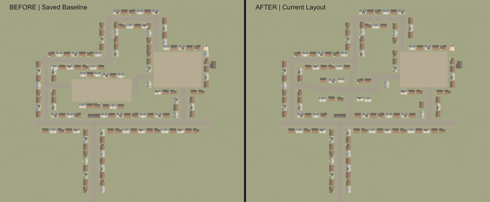

# 2026년 11월 19일 카랑탕 시가지 변경

중앙의 작은 광장을 도로와 주택 블록으로 바꾸고, 코너 시야와 연결 골목을 정리했다. 오른쪽의 큰 시장 광장은 유지했다.

## 비포·애프터

왼쪽은 오늘 변경 전 마지막 Git 저장본인 `1f7098d`(2026년 11월 17일), 오른쪽은 이번 변경을 반영한 Carentan 씬이다. 두 상태를 Unity에서 같은 카메라 위치와 배율로 직접 렌더링했다. 오늘 시작 시점의 미저장 편집 상태를 별도로 복원한 이미지는 아니다.

## 반영 내용

- 주택가 코너의 A 건물을 삭제하고, 시장 광장 서쪽 B 건물을 서쪽으로 14m 이동해 코너 시야를 열었다.
- 사용자가 직접 삭제·조정한 건물 배치를 보존하고, 카페 오른쪽에서 북쪽 주택가로 이어지는 자갈길을 연결했다.
- 건물 경계가 겹친 5쌍에서 한 채씩 삭제해 겹침을 정리했다.
- 카페 뒤 중앙의 작은 흙 광장을 없애고, 동서 10m 도로와 남북 8m 연결길로 바꿨다. 교차로와 동쪽 굴곡은 넓혀 연결했다.
- 기존 Low Poly War Pack 주택 10채를 동서 도로 북쪽과 남쪽에 5채씩 배치했다. 전체 건물은 비교 기준의 142채에서 현재 133채로 변경됐다.
- 지면과 자갈길은 기존 Terrain과 Terrain 레이어를 사용했다. 도로 밖 NavMesh 제외 볼륨을 새 도로에 맞추고, 기존 TankFlat NavMesh 에셋의 GUID와 씬 참조를 유지해 재베이크했다.

구체적인 도로 좌표는 [카랑탕 블록아웃 문서](Carentan-Blockout.md)에 정리했다. [거리 연출 계획](Carentan-Street-Dressing.md)은 추가 소품과 식재에 대한 구상이며, 해당 계획의 나무·차양 등을 이번 변경으로 새로 배치하지 않았다.

## 확인 범위

새로 배치한 주택의 렌더링 경계가 겹치지 않는지, Terrain 페인트가 재임포트 후 유지되는지, 씬 저장과 NavMesh 에셋 참조가 유지되는지 확인했다. 비교 이미지 촬영 중 실제 씬 배치는 변경하지 않았다. 플레이 테스트는 사용자 요청에 따라 생략했다.
