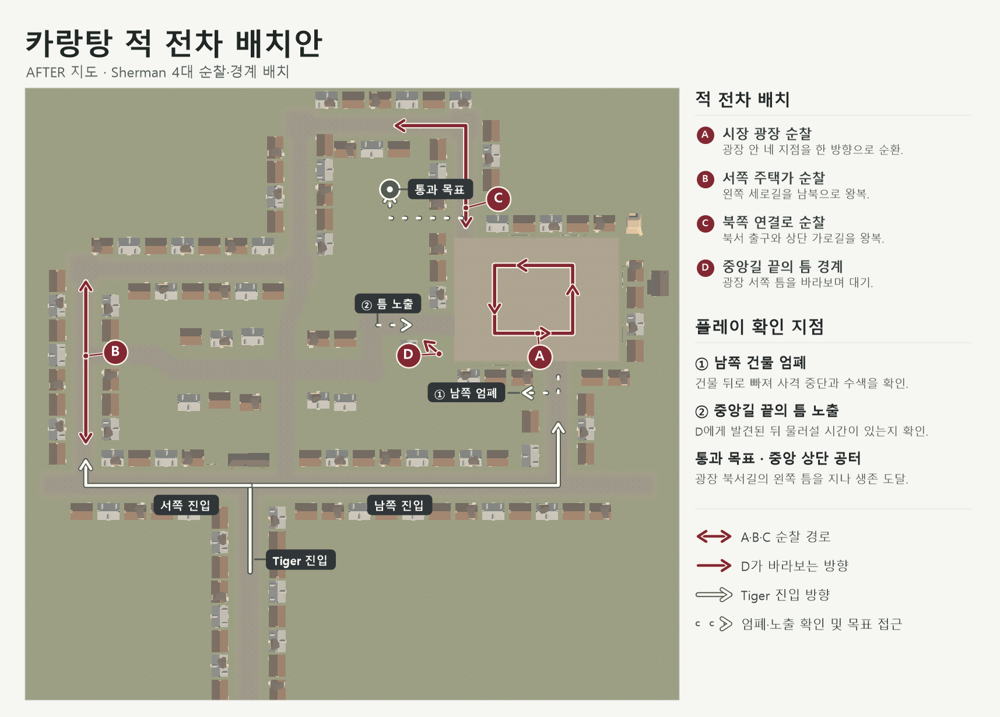

# 카랑탕 시가지 블록아웃 계획

《밴드 오브 브라더스》 3화 〈Carentan〉의 시가지 진입 장면에서 착안해, 약 **500m × 500m**의 임시 인게임 맵을 만든다. 남쪽에서 접근하면 T자 교차로 건너편의 카페가 정면에 보이고, 교차로에서 방향을 바꾸면 시장 광장과 주택가 골목으로 이어진다. 광장은 카랑탕의 레퓌블리크 광장을 참고해 배치한다. [3화 〈Carentan〉](https://www.hbomax.com/kn/en/show/6a0a0227-f567-46ba-9a2d-04374c5f6193/s1/e3-carentan/f9641dcf-f772-49a0-b510-8ca0254be598) · [카랑탕 T자 교차로 현장 자료](https://battlefieldtravels.com/battle-of-carentan/) · [코탕탱 관광청의 카랑탕 도심 안내](https://www.ot-baieducotentin.fr/en/jexplore/patrimoine/villes-villages/carentan-les-marais/)

씬, Terrain, NavMesh와 로컬 전차 조작을 `Carentan`에 배치했다. 마지막 Play Mode 주행은 사용자가 확인한다.

## 세 구역과 주행 동선

```text
                           북쪽 (+Z)

              ┌───────── 골목 ─────────┐
              │                        │
     ┌────────┘                        │
     │ C 주택가 골목              B 시장 광장
     │                                 │
     │         카페 정면               │
     └───────── A T자 교차로 ──────────┘
                      │
                   전차 출발
```

| 구역 | 배치 | 주행 경험 |
| --- | --- | --- |
| **A · 진입로와 T자 교차로** | 남쪽 진입로 끝의 맞은편에 `building-cafe_T`를 두고 정면을 출발점 쪽으로 향하게 한다. 교차로 양옆에는 건물을 도로 가까이에 배치한다. | 진입 중 카페를 기준으로 방향을 잡고, 교차로에 가까워지면 양옆 거리의 시야가 열린다. |
| **B · 시장 광장** | 교차로에서 동쪽으로 우회전한 뒤 북쪽으로 꺾으면 약 80m × 60m 광장이 열린다. `building-medium`과 `building-house-big`을 가장자리에 두고 중앙은 비운다. | 골목을 벗어나면서 시야가 넓어지고, 광장에서 전차가 방향을 바꿀 수 있다. |
| **C · 주택가 골목** | 교차로에서 서쪽으로 좌회전하면 `building-house-middle`, `building-house-big`과 파손 변형이 이어진다. 건물 열을 엇갈리게 두고, 꺾이는 골목을 시장 뒤편에 연결한다. | 코너에서 시야가 짧아진다. 시장까지 이어지는 골목을 이용해 마을 안에서 한 바퀴 돌 수 있다. |

카페 뒤 중앙의 작은 흙 광장은 도로와 주택 블록으로 바꿨다. C 주택가에서 B 시장 광장 서쪽으로 이어지는 동서 자갈길은 기준 폭 10m이며, 카페 오른쪽의 폭 8m 남북길과 `(-67, 6)`에서 교차한다. 교차로와 동쪽 굴곡은 회전 여유를 두고 넓혔다. 기존 Low Poly War Pack 주택 10채를 동서 도로 북쪽과 남쪽에 5채씩 배치하고, 건물 내부와 도로 밖은 NavMesh에서 제외했다. 오른쪽의 큰 시장 광장은 유지한다.

### 첫 배치 치수

- 지면은 평지로 잡고 맵 중심을 원점에 둔다. Unity의 `+Z`를 북쪽, `+X`를 동쪽으로 사용한다. X와 Z의 범위는 각각 `-250m`에서 `+250m`다.
- Terrain 도로 페인트의 기준 폭은 주도로 **10m**, 우회 골목 직선부 **8m**다. 급한 골목 코너의 페인트는 **14m × 14m**로 넓어지며, 가장자리에서 자갈이 흙과 잔디로 섞인다. NavMesh 베이크에 사용한 기본 도로 범위는 주도로 14m, 골목 직선부 10m다. 실제 전차 통과 폭은 건물 Collider 사이 간격으로 확인한다.
- 아래 좌표는 기존 평면 배치를 옮기기 위한 첫 배치 기준점이다. 단위는 미터이며 좌표 순서는 `(X, Z)`다.

| 기준점 | 시작 좌표 |
| --- | --- |
| 남쪽 전차 출발점 | `(-85, -195)`, 북향 |
| A 교차로 중심 | `(-85, -50)` |
| B 광장 진입 코너 | `(65, -50)` |
| B 광장 중심 | `(55, 40)` |
| C 골목 입구와 굴곡 | `(-165, -50) → (-165, 55) → (-60, 55) → (-60, 125) → (20, 125)` |
| C에서 B로 연결되는 광장 뒤편 | `(20, 70)` |
| 중앙 시가지의 동서 연결 | `(-165, 13) → (-132, 13) → (-120, 6) → (-25, 6) → (-25, 28) → (15, 28)` |
| 카페 오른쪽 남북 연결 | `(-67, -50) → (-67, 24) → 북쪽 굴곡 → (-60, 55)` |

## Unity 씬과 건물 프리팹

- 씬은 `Assets/TankPrototype/Scenes/Carentan.unity`에 저장했다. `Town Geometry` 아래에 Terrain, 세 구역의 건물, 도로 밖 베이크 제외 볼륨을 배치했다.
- `Assets/TankPrototype/Terrain/Carentan/CarentanTerrain.asset`은 가로·세로 500m, 높이 범위 40m인 TerrainData다. 도로와 광장은 Terrain 레이어로 칠해 Terrain을 조각하면 표면을 함께 따라간다. 건물과 전차 출발점은 씬에서 별도로 높이를 맞춘다.
- 주도로와 골목은 `Road.terrainlayer`의 `CarentanGravel.png`를 사용한다. 자갈 타일 크기는 3m × 3m다. 시장 광장과 도로 가장자리의 밝은 흙띠는 `Market` 레이어를 사용한다.
- **건물은 프로젝트에 들어 있는 `Assets/polyperfect/Low Poly War Pack/Prefabs/Buildings`의 기존 프리팹만 사용한다.** 원본 프리팹을 인스턴스로 배치하고 개별 위치와 회전을 조정한다. 파손 주택은 팩의 `building-house-middle-broken` 같은 기존 변형을 사용한다.
- 건물 충돌은 프리팹의 `MeshCollider`부터 사용한다. 통행을 막아야 할 부분의 Collider가 비어 있으면 씬 인스턴스에서 보완한다. 기존 플레이어 전차와 `EnemyTank-Sherman`을 주행 확인에 사용한다.

## 전차 AI용 도로 NavMesh

이 씬은 AI Navigation 2.0.14에서 기존 **`TankFlat`** Agent Type과 `TankPath`를 사용한다. 로컬 Fusion 세션에서 `EnemyTank-Sherman`을 생성한 뒤 `SetMoveMode(NavMesh)`를 호출한다. [기존 전차 AI 가이드](TankAI.md)

### 베이크 설정

1. `Town Geometry`의 `NavMeshSurface`는 `TankFlat` 설정인 반경 3.8m, 높이 3.5m, 최대 경사 16°, 단차 0.1m를 사용한다. 차체와 포신의 코너 회전 여유는 실제 주행으로 확인한다.
2. `Physics Colliders`와 `Current Object Hierarchy`로 Terrain과 건물의 실제 충돌 형상을 수집한다. Terrain 한 장이 접지와 도로 표면을 함께 제공한다.
3. 표면 기본 영역은 `Road`다. `Off-road bake exclusion` 아래의 `NavMeshModifierVolume`과 건물의 `NavMeshModifier`를 `Not Walkable`로 지정해 도로 밖 지면과 건물 표면을 제외한다.
4. 베이크한 데이터는 `Assets/TankPrototype/Terrain/Carentan/NavMesh-TankFlat.asset`에 저장했다. 도로를 옮길 때는 Terrain 페인트와 제외 볼륨을 함께 수정한다. Terrain 높이나 건물 위치를 바꾼 뒤에는 `Town Geometry`의 `NavMeshSurface`에서 다시 베이크하고 저장한다. Terrain 타일을 추가할 때는 베이크 계층과 제외 범위를 함께 확장한다. [Unity `NavMeshSurface` 문서](https://docs.unity3d.com/Packages/com.unity.ai.navigation@2.0/manual/NavMeshSurface.html)

### 기존 전차 AI와 연결

- `TankPath`는 `TankFlat`과 기존 `AllAreas` 마스크를 사용한다. 이 씬에서는 `Road`만 주행 가능한 표면으로 남긴다. 출발점과 목적지의 NavMesh 보정 거리는 기존 0.75m다.
- `TankPath`가 완전한 경로를 계산하면 `TankAI`가 저장된 코너를 순서대로 추종하고 `TankMotor`가 차체를 구동한다. `CarentanDrive`의 순찰은 각 지점에서 `Arrived`가 확인되면 다음 목적지를 전달하고, `Failed`가 되면 정지한다.

### 로컬 조작

- Unity에서 `Carentan`을 열어 Play하면 로컬 Fusion `Single` 세션이 시작된다. 세션과 Tiger가 준비되면 `TankSceneLink`가 기존 `TankInterior`를 Additive로 불러오고 내부 화면을 연다.
- **1 / 2 / 3**으로 조종수·포수·전차장 좌석을 요청하고, 장치를 바라본 상태에서 **Space**로 사용한다. 조종석 레버를 잡은 상태에서 **W/S**와 **I/K**가 왼쪽·오른쪽 레버를 조작하고, **Q/U**가 각각 중립으로 돌린다. **F8 / F9**는 외부·내부 시점 전환이다. [기존 내부 조작 가이드](TankTest-SceneSplit-README.md#8-현재-조작과-기능-확인-순서)
- **7**로 Sherman 순찰을 시작하면 차체 뒤를 따라가는 카메라로 전환된다. 경로는 **A → B → 광장 뒤편 → C → A**다. **F8**은 Tiger 외부 시점, **F9**는 내부 시점으로 돌아가고, **F5**는 순찰을 다시 시작하지 않고 Sherman을 관찰한다. **8**은 도로 밖 목적지를 요청하고 결과를 Console에 기록한다. **9**는 순찰을 중지한다.

### 시장 광장 자율 교전 시험

1. Edit Mode에서 Hierarchy의 **Carentan Drive**를 선택한다. Inspector의 **Layout**에서 **광장 순찰만**, **광장 20m 교전**, **광장 35m 교전** 중 하나를 고른다. **기존 도로 주행**으로 실행하면 기존 출발 위치에서 시작한다.
2. Play 후 **광장 시험 시작 (0)**을 누른다. Game 뷰에 포커스가 있으면 `0`으로도 시작할 수 있다. Sherman을 따라가는 화면과 Inspector의 **교전 상태, 순찰 경유점, 이동·사격 상태, 실제 발사 수, Tiger HP**를 함께 본다.
3. **시험 정지 (9)**로 이동과 사격을 끝낸다. 동일한 시작 위치와 HP에서 다시 시험하려면 Play Mode를 다시 시작한다.

| 배치 | 하위 AI 구조도 기준 통과 조건 |
| --- | --- |
| 광장 순찰만 | `Patrol`에서 실제로 1번과 2번에 도착한 뒤 다시 1번을 향해 출발한다. 발사 수는 0이다. |
| 광장 20m 교전 | `Patrol → StopAndFire`로 전이한다. 차체가 안정된 뒤 실제 포탄이 발사되고 Tiger HP가 감소한다. |
| 광장 35m 교전 | `Patrol → Approach → StopAndFire` 순서가 보인다. 차체가 이동하는 동안 포탑·포신이 표적을 추적하고 발사 수는 0이다. 멈춘 뒤 발사·피격을 확인한다. |
| 시험 정지 | `Idle` 상태에서 새 경로·사격이 시작되지 않는다. 정지 전에 이미 발사한 포탄은 계속 날아갈 수 있다. |

사격이 안 되면 Inspector의 이동 실패·사격 차단 메시지와 Console의 `[AI COMBAT]` 전이 사유를 먼저 확인한다. 상태 구조는 [적 전차 하위 AI 구현도](EnemyTankAI-Implementation-Draft.html)를 따른다.

### 시장 남쪽 진입과 건물 엄폐 시험

1. Edit Mode에서 **Carentan Drive → Layout → 시장 남쪽 진입**을 선택하고 Play한다. **광장 시험 시작 (0)**을 누르면 Sherman이 시장 남쪽에서 순찰을 시작하고 화면은 Tiger 내부에 남는다.
2. Game 뷰에서 `F9`, `1`로 조종석 시점과 좌석을 선택한다. 조종 장치를 보고 `Space`를 누른 뒤 `W`와 `I`로 양쪽 레버를 전진시켜 북쪽 광장에 접근한다. 양쪽 레버를 중립으로 돌릴 때는 `Q`와 `U`를 누른다. `F5`는 Sherman을 따라가고, `F9`는 Tiger 내부로 돌아온다. 다시 주행하려면 장치를 다시 잡는다.
3. 같은 상황을 재현하려면 새 Play에서 **광장 시험 시작 (0) → Tiger 노출점으로**를 누른다. Sherman이 발사하고 Tiger HP가 처음 줄면 **Tiger 건물 뒤로**를 누른다. Scene 뷰에서 **Carentan Drive**를 선택하면 출발점·노출점·엄폐점이 표시된다.

| 시나리오 | 조작과 통과 조건 |
| --- | --- |
| 남쪽 진입 | Tiger를 몰고 올라갈 때 Sherman이 `Patrol`에서 접근 또는 정지 사격으로 바뀌고 첫 발이 나간다. |
| 수색 중 재발견 | `MoveToLastSeen`이 보일 때 **Tiger 노출점으로**를 누른다. Sherman이 수색을 중단하고 같은 Tiger와 교전을 재개한다. |
| 끝까지 엄폐 | **Tiger 건물 뒤로**를 누른 뒤 기다린다. `WaitForSight → MoveToLastSeen → CheckSurroundings → ReturnToPatrol → Patrol`이 이어지고, 기존 경유점 도착 후 다음 경유점으로 이동한다. |

가려진 동안 실제 발사 수가 늘지 않는지 확인한다. Inspector의 **Tiger 시야 판정**이 `Occluded`일 때 가리는 오브젝트 이름이 표시된다. **이동 목적지**와 **마지막 목격 위치**를 비교하면 Sherman이 실제 Tiger 대신 마지막 목격점으로 향하는지 확인할 수 있다. Console에서 `[AI COMBAT]`를 검색하면 지나간 상태와 사유가 남는다. 재시험은 Play를 다시 시작해 체력과 위치를 초기화한다.

### 광장 사선 차단과 근거리 이격 시험

1. Edit Mode에서 **Carentan Drive → Layout**의 아래 배치 중 하나를 선택한다. 매 배치는 Play Mode를 다시 시작해 위치와 체력을 초기화한다.
2. Play 후 Inspector에서 **광장 시험 시작 (0)**을 누른다. Game 화면은 Sherman 뒤에서 따라가고 Inspector에는 교전 상태, Tiger 시야, 실제 발사 수, 위치 변경 횟수와 이격 거리가 표시된다. 다른 시점에 있다면 Game 화면을 클릭하고 `F5`를 누른다.
3. Tiger 체력이 처음 줄었을 때 에디터를 일시 정지하면 첫 명중 직후의 발사 수와 이동 결과를 확인할 수 있다. Console에서 `[AI COMBAT]`를 검색하면 지나간 상태가 보인다.

| Layout | 통과할 때 보이는 동작 |
| --- | --- |
| **광장 사선 차단 · 위치 변경** | Tiger 시야는 `Visible`인 채로 낮은 차단물이 탄도를 약 0.3초 막는다. `Reposition`으로 전환해 한 번 자리를 옮기고, 멈춘 후 첫 발이 맞는다. 이동 중 발사 수는 0이다. |
| **광장 근거리 · 후방 열림** | Sherman이 약 7.5m 앞의 Tiger를 보면서 한 번 후진한다. `BackOff` 동안 발사 수는 0이고, 약 12m로 벌린 뒤 정지 사격한다. |
| **광장 근거리 · 후방 막힘** | 뒤 차단물 때문에 후진 거리 0m, 사유 `Rear obstacle`이 표시된다. 제자리에서 사격 판단을 이어간다. |

광장에 배치한 두 시험용 차단물은 해당 시험에서만 켜진다. 시야 판정이 `Occluded`라면 Sherman이 Tiger 자체를 잃은 것이므로, `Visible` 상태에서 탄도만 막히는 시험과 구분한다.


### 남쪽·서쪽 진입로와 전차 수 비교

남쪽 Sherman은 `(65, -3)`에서 시장 남쪽 도로를 북쪽으로 올라온다. 서쪽 Sherman은 `(9, 28)`에서 기존 중앙 안마당의 동서 통로를 지나 광장 서쪽 입구로 들어온다. 네 배치 모두 Tiger가 `(55, 39)`에서 HP 100으로 시작한다. 좌표는 `(X, Z)`다.

1. Edit Mode에서 **Carentan Drive → Layout**을 고른다. Scene 뷰에서 남쪽 경로는 노란색, 서쪽 경로는 하늘색으로 표시된다.
2. Play 후 **진입 시험 시작 (0)**을 누른다. **광장 전체 보기**에서 두 접근 방향을 볼 수 있다. 개별 전차가 어떻게 코너를 지나거나 멈추는지 보려면 **남쪽 Sherman 따라가기** 또는 **서쪽 Sherman 따라가기**를 누른다.
3. Inspector에서 각 Sherman의 **교전 / 이동**, **순찰 경유점**, **Tiger 시야 판정**, **실제 발사 / 피해를 준 탄**을 본다. 위쪽의 **Tiger HP / 피격**과 각 Sherman의 HP를 함께 비교한다. Console은 `[Carentan Entry]`로 출발 로그, `[AI COMBAT]`으로 상태 전이를 찾을 수 있다. 상태 전이 로그를 클릭하면 해당 Sherman을 확인할 수 있다.
4. **시험 정지 (9)**를 누르면 순찰·교전이 중단되고 순차 배치의 대기 중인 서쪽 출발도 취소된다. 초기 위치와 HP로 비교하려면 Layout을 바꾸기 전에 Play를 종료한다.

| Layout | 화면에서 확인할 동작 |
| --- | --- |
| **진입 검증 · 서쪽 1대** | 안마당 통로에서 광장 쪽으로 움직인다. Tiger 발견 후 접근하고, 정지 뒤 첫 발이 맞는다. |
| **진입 비교 · 남쪽 1대** | 남쪽 도로에서 진입한다. 첫 발견·발사와 Tiger가 받는 피해를 비교 기준으로 삼는다. |
| **진입 비교 · 2대 순차** | 남쪽이 먼저 출발한다. Inspector에 표시된 4초가 지나면 서쪽이 생성되어 출발한다. |
| **진입 비교 · 2대 동시** | 시작 버튼 한 번으로 두 Sherman이 각각의 출발점에서 움직인다. 각 Sherman의 발사 수와 Tiger HP를 확인한다. |

#### 비교 결과

Unity 6000.6.3f1의 로컬 Play Mode에서 각 배치를 두 번 실행했다. Tiger는 시작 위치에서 정지해 있었다. 아래 시간은 **진입 시험 시작**을 누른 뒤의 시뮬레이션 시간이다.

| 배치 | 최초 명중 | 10초 시점 Tiger HP | Tiger 파괴 | 전차별 명중 수 |
| --- | --- | ---: | ---: | --- |
| 서쪽 1대 | 서쪽 8.2~8.3초 | 50 | 약 13.0초 | 서쪽 4회 |
| 남쪽 1대 | 남쪽 약 7.2초 | 50 | 약 11.9초 | 남쪽 4회 |
| 2대 순차 | 남쪽 약 7.2초 | 50 | 약 11.9초 | 남쪽 4회, 서쪽 0회 |
| 2대 동시 | 남쪽 약 7.2초, 서쪽 약 8.2초 | 0 | 약 9.7초 | 남쪽 2회, 서쪽 2회 |

서쪽 단독은 약 3.3초에 Tiger를 발견했고, 광장 서쪽 입구를 통과해 약 `(32, 32)`에서 정지 사격했다. 순차 배치에서는 서쪽이 4초에 출발했고 약 11.2초에 첫 발을 쐈다. 서쪽 포탄이 도달하기 전에 남쪽의 네 번째 탄착으로 Tiger가 파괴됐다. 동시 배치에서는 두 방향의 탄착이 겹쳤고, 남쪽 단독보다 약 2.2초 일찍 Tiger가 파괴됐다. 두 대 배치에서 Sherman 사이의 최소 거리는 약 34m였다. 시험 정지로 순차 출발을 예약한 상태와 이미 두 대가 출발한 상태가 각각 취소되는 것도 확인했다.

### 도로·건물 변경 후 확인

Edit Mode에서 **Carentan Drive → Layout**을 고르고 Play한다. 로컬 Fusion 세션이 씬을 찾지 못하면 **Build Profiles → Scene List**에서 `Carentan`과 `TankInterior`가 활성화돼 있는지 확인한다. 초기 위치와 체력으로 다시 확인할 때는 Play를 재시작한다.

| Layout | 조작과 확인할 동작 |
| --- | --- |
| **진입 검증 · 서쪽 1대** | **진입 시험 시작 (0)**과 **서쪽 Sherman 따라가기**를 누른다. 기존 출발점 `(9, 28)`에서 시장 입구를 지나 접근한다. 정지 후 첫 탄착으로 Tiger HP가 줄어드는지 본다. |
| **맵 변경 · 중앙 연결로 주행** | **중앙 연결로 주행 시작 (0)**을 누른다. Sherman이 `(-85, 6)`에서 교차로와 시장 앞 굴곡을 지나 `(29, 28)`에 도착한다. Inspector의 **다음 경로 지점**, **이동 목적지**, **이동 상태**를 보고 마지막에 `Arrived`인지 확인한다. |
| **맵 변경 · 시장 서쪽 틈 교전** | **틈 교전 시작 (0)**을 누른다. Tiger는 `(-23, 28)`의 건물 뒤에서 시작한다. **틈에 노출**을 눌러 `(-7, 28)`로 옮기고 실제 발사와 HP 감소를 확인한다. **건물 뒤로** 돌아간 직후 **Tiger 시야 판정**이 `Occluded`로 바뀌고 새 발사가 멈추는지 본다. |

Tiger를 직접 몰아보려면 마지막 배치를 새로 열고 **틈 교전 시작 (0) → F9 → 1 → 조종 장치를 보고 Space** 순서로 조작한다. `W`와 `I`로 동쪽을 향해 주행하고 `Q`와 `U`로 두 레버를 중립에 둔다. `F5`는 Sherman 시점, `9`는 시험 정지다. `[AI COMBAT]`으로 교전 전이를 찾을 수 있다.

Unity 6000.6.3f1 로컬 Play에서 머지된 씬과 동일한 복사본으로 확인했다. 좌표는 `(X, Z)`다.

| 확인 항목 | 결과 |
| --- | --- |
| 기존 서쪽 1대 | `(18.32, 28)` 부근에서 발견하고 `(31.64, 31.91)` 부근에서 정지 사격했다. 8.20초에 첫 탄착했고 Tiger HP는 100에서 75로 줄었다. |
| 중앙 연결로 | 교차로와 굴곡을 통과해 31.66초에 `Arrived`가 됐다. 발사는 0발이었다. |
| 서쪽 틈에서 멈춰 확인 | 건물이 가린 상태에서 시작했다. 틈에 노출 후 19.18m에서 발견해 명중했고, 같은 건물 뒤로 돌아가자 시야가 차단됐다. 엄폐 직후 확인 구간의 새 발사는 0발이었다. |
| Tiger로 서쪽 틈 통과 | Sherman은 Tiger가 `(-17.07, 28)`를 지날 때 처음 발견했고, `(-12.65, 28)`를 지날 때 처음 맞혔다. Tiger가 `(-1, 28)`까지 전진해도 `Visible` 상태가 이어졌다. |
| 남쪽 기존 엄폐점 | 노출점에서 명중 후 기존 엄폐점으로 옮기자 `building-house-big`이 시야를 막았다. 엄폐 직후 확인 구간의 새 발사는 0발이었다. |

### 4대 배치 디버그



`Carentan` 씬에서 **Carentan Drive → Layout → 적 배치 디버그**를 선택한다. Edit Mode에서 **적 선택**의 A~D를 체크하면 해당 Sherman만 생성된다. 모두 해제하면 Tiger 주행만 시험할 수 있다. **Tiger 출발점**은 남쪽 도로 `(-85, -92)`, 남쪽 코너 `(65, -20)`, 서쪽 틈 건물 뒤 `(-23, 28)` 중에서 고른다. 남쪽 출발점은 북향, 서쪽 틈은 동향이다. Scene 뷰에서 선택한 출발점·방향, 남쪽 엄폐 후보와 중앙 상단 공터를 볼 수 있다. 좌표는 `(X, Z)`다.

로컬 Fusion 세션에 사용하는 **Build Profiles → Scene List**에서 `Carentan`과 `TankInterior`를 활성화한 뒤 Play한다. 호스트가 준비되면 선택한 Sherman이 아래 시작점에서 대기한다. 남쪽 코너는 A 단독 반복, 서쪽 틈 건물 뒤는 D 단독 반복에 사용할 수 있다.

Edit Mode에서 **Layout** 아래에 **Tiger 시작 HP**(기본 300), **Tiger 무적**, **우측 하단 지도**가 있다. 무적을 켜면 실제 HP를 유지하면서 차단한 명중의 예상 피해를 가상 HP에 누적한다. Play 중에는 전차 추적 버튼 아래에서 **같은 설정으로 재시작**과 **Tiger 무적** 상태를 바로 볼 수 있다. 하단에는 무적 차단 횟수, 가상 HP와 가상 파괴 시각이 표시된다. 지도를 켜면 조종 중 북쪽이 위인 탑뷰가 표시되고, 청록색 화살표는 Tiger의 위치와 차체 방향을 가리킨다.

| 전차 | 시작점 | 순찰·경계 경로 |
| --- | --- | --- |
| A · 시장 광장 | `(55, 24)` | `(72, 24) → (72, 57) → (34, 57) → (34, 24) → (72, 24)` |
| B · 서쪽 주택가 | `(-165, 13)` | `(-165, 49) ↔ (-165, -29)`. 양 끝에 동쪽으로 1m 떨어진 회전 경유점을 거친다. |
| C · 북쪽 연결로 | `(20, 85)` | `(20, 76) ↔ (20, 125) ↔ (-14, 125)` |
| D · 중앙길 틈 | `(7, 14)`, 북서향 | `(6, 15)`로 짧게 이동해 틈을 감시한다. |

1. **전체 탑뷰**를 누른다. Game 뷰 위쪽이 북쪽이며 `Tiger`와 생성된 Sherman의 라벨이 차체를 따라간다.
2. **시험 시작 (0)**으로 선택한 전차의 순찰과 경계를 시작한다. 시작할 때 시험 시간이 0초로 잡힌다. Inspector에서 전차별 교전·이동 상태와 경유점 번호를 본다.
3. **전차 따라가기**의 `Tiger` 또는 생성된 적 버튼으로 차체 뒤에서 관찰한다. **전체 탑뷰**로 돌아가도 전차는 같은 순찰을 이어간다.
4. **조종석 복귀** 후 장치를 잡고 Tiger를 직접 조종한다. 로컬 시험에서 **포수석 이동**을 켜 두면, 시험 중 `2`로 포수석에 앉아 `W/S`로 전진·후진하고 `A/D`로 선회할 수 있다. 키를 놓으면 레버가 중립으로 돌아간다. 조준·장전·발사는 기존 포수 조작을 쓴다. 시점 전환이나 포커스 상실 뒤에는 이동 키를 뗐다가 다시 눌러야 한다.
5. **시험 정지 (9)**는 시험 시간을 멈추고 선택한 적의 이동·교전 명령과 포수석 이동 입력을 중단한다. Tiger가 파괴돼도 같은 방식으로 시험이 종료된다. 비행 중이던 포탄은 기존 충돌·수명 처리를 따른다.
6. **같은 설정으로 재시작**을 누르면 로컬 Play 세션이 새로 열린다. 적 조합과 출발점이 유지되고 Tiger 위치·방향·HP, 약실과 손에 든 탄, 적 순찰과 남은 포탄이 초기화된다. 준비 상태에서 필요하면 다시 장전하고 `0`을 눌러 다음 판을 시작한다. 적 조합이나 출발점을 바꾸려면 Edit Mode에서 설정한다.

로컬 시험에서 적을 처음 알아차리면 `B`로 시각과 위치를 표시할 수 있다. 시험 종료 후 `Builds/CarentanTrials/`에 탭으로 구분한 기록이 저장된다. `sight_lost`는 적 센서가 Tiger를 놓친 순간이고, `shot_path_blocked`는 포구 쪽 탄도가 막힌 판단이다. 발사 전차와 탄 번호로 `shot_fired`와 `shot_impact`를 연결하면 엄폐 전에 출발한 탄인지 확인할 수 있다. Tiger 발사는 요청 번호로 `fire_request`, `fire_rejected` 또는 `shot_fired`를 연결한다. 엄폐점 도달과 적의 시야 상실은 각각 기록된다.

남쪽 진입은 `(48, -5)` 건물 뒤로 빠지면서 A의 시야와 새 발사를 확인한다. 서쪽 진입은 `(-23, 28) → (-7, 28)` 틈을 건너며 D의 탐지·발사·피격 순서를 본다. 배치안의 통과 목표는 중앙 상단 공터 `(-17, 94)`다.

로컬 Play에서 A는 네 모서리를 돌아 첫 경유점에 다시 도착했고, B는 양쪽 끝을 두 번 왕복했으며, C는 상단 굴곡을 지나 남단에 복귀했다. D는 경계점에 도착해 대기했다. 탑뷰, Tiger와 A~D의 개별 추적, 조종석 복귀, 4대 정지를 확인했다. 기존 서쪽 1대 시험에서도 첫 탄착을 확인했다.

중앙길 시험에서는 D의 첫 탄착으로 Tiger HP가 100에서 75로 줄었고, 건물 뒤로 옮긴 뒤 추가 발사는 없었다. 남쪽 시험에서는 첫 피격 후 조작 입력으로 후진했으나, Tiger가 `(65, -7)` 부근에서 방향을 돌리는 중 파괴됐다. 엄폐점까지 생존해서 들어가는 건 다음 주행에서 확인할 항목이다.

## 구현 순서와 완료 기준

1. 바닥, 도로, 출발점을 배치하고 A → B → C → A가 이어지는지 확인한다.
2. Low Poly War Pack 프리팹으로 건물 열을 만든다. 운전석에서 진입로 끝의 카페가 보이는지, 광장이 코너를 돈 뒤 열리는지, 가장 좁은 골목에서 회전과 후진이 가능한지 확인한다.
3. 전차용 NavMesh를 베이크한다. Scene 뷰에서 세 구역과 광장 뒤편 연결로가 연속인지, 건물 내부·지붕·도로 밖에 전차 경로가 생기지 않는지 확인한다.
4. Play Mode에서 호스트가 `EnemyTank-Sherman`에 A → B, B → C, C → A 목적지를 지정한다. B → C는 광장 뒤편 골목에 놓인 시험 지점을 거치게 해 우회 연결도 검증한다. 각 경로가 `PathComplete`이며 전차가 건물에 걸리지 않고 실제로 도착해야 한다. 도로에서 떨어진 도달 불가 지점도 지정해 실패 처리를 확인한다.
