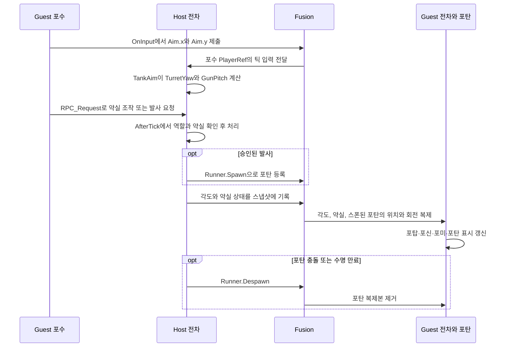

# 전차 무장 네트워크 동기화

2026-11-10 기준. Unity `6000.6.3f1`, Photon Fusion `2.1.3`의 Host Mode를 사용한다. `TankTest`를 실행하면 `SessionJoinInit`이 `GameMode.AutoHostOrClient`로 `MySession`을 시작하거나 참가한다. 먼저 들어온 Host와 Guest 두 명이 한 대의 전차를 공유한다. [세션 초기화 코드](../Assets/TankPrototype/Scripts/network/SessionJoinInit.cs)

## 1. 입력과 상태의 흐름

조준은 플레이어별 **틱 입력**, 약실 조작은 **한 번씩 처리하는 요청**, 포탑 각도와 약실 결과는 **Host가 확정한 네트워크 상태**로 다룬다. 포탄은 Host가 스폰하는 별도 네트워크 오브젝트다.



`TankInput.ReadAim()`은 `←/→`를 `Aim.x`, `↑/↓`를 `Aim.y`로 읽는다. `TankControl`은 두 축을 로컬 `pendingInput.Aim`에 저장하고, `SessionJoinInit.OnInput()`은 `SubmitNetworkInput()`을 통해 레버값과 조준 입력이 담긴 구조체를 한 번에 제출한다. Fusion은 입력을 `PlayerRef`별로 관리한다. Host의 `TankMotor`는 Driver의 레버값을, `TankAim`은 Gunner의 조준값을 같은 틱에서 각각 읽는다. [키 입력](../Assets/TankPrototype/Scripts/TankInput.cs) · [입력 저장과 제출](../Assets/TankPrototype/Scripts/TankControl.cs) · [입력 구조체](../Assets/TankPrototype/Scripts/network/TankCrewNetworkInput.cs) · [차체 구동](../Assets/TankPrototype/Scripts/TankMotor.cs)

`TankCrewRegistry`는 세 역할의 `PlayerRef`를 복제한다. 초기 배정은 Host가 Driver, 첫 Guest가 Gunner, 두 번째 Guest가 Commander다. 접속 이벤트가 전차 스폰보다 먼저 오면 대기 목록에 보관했다가 `Spawned()`에서 반영한다. 각 인스턴스는 `Runner.LocalPlayer`의 역할을 자기 좌석에 적용한다. Host의 `F10`은 Driver와 Gunner를 교체하며 전차의 State Authority는 Host에 있다. [역할 관리](../Assets/TankPrototype/Scripts/network/TankCrewRegistry.cs)

## 2. 포탑 Yaw와 포신 Pitch

두 각도의 네트워크 상태는 `TankAim`에 있다. Host의 `FixedUpdateNetwork()`가 현재 Gunner의 입력을 한 번 조회하고, 두 축을 각각 계산한다.

| 축 | Host가 복제하는 값 | 계산과 적용 |
| --- | --- | --- |
| 포탑 좌우 | `TurretYaw` | `Aim.x × YawSpeed × Runner.DeltaTime`을 더한 뒤 각도를 360° 범위로 순환시킨다. `turretBase * Quaternion.AngleAxis(yaw, Vector3.up)`으로 적용한다. |
| 포신 상하 | `GunPitch` | `Aim.y × PitchSpeed × Runner.DeltaTime`을 더한 뒤 `MinPitch`와 `MaxPitch` 사이로 제한한다. `gunBase * Quaternion.AngleAxis(-pitch, Vector3.right)`로 적용한다. |

TigerTank의 기본값은 Yaw 초당 60°, Pitch 초당 30°, 상하 범위 −10°에서 +30°다. 축별로 처리하므로 좌우 입력이 0이어도 포신을 올릴 수 있다. Host는 계산 직후 피벗을 돌리고, Guest는 스폰 시 초기 상태를 적용한 뒤 `Render()`에서 복제된 각도를 적용한다. Fusion은 시뮬레이션 틱에서 확정한 상태를 전송 주기에 맞춰 보낸다. `Render()`는 받은 값으로 화면을 갱신한다. [각도 계산과 피벗 적용](../Assets/TankPrototype/Scripts/TankAim.cs) · [TigerTank 설정](../Assets/TankPrototype/Prefabs/TigerTank.prefab)

`CurrentPitch`는 `ApplyPitch()`가 포신에 적용한 각도를 담는 일반 프로퍼티다. 네트워크 플레이에서는 `GunPitch`를 적용하는 시점에 갱신되고, 오프라인에서는 `ApplyInput()`이 이전 `CurrentPitch`로 다음 각도를 계산한다. HUD는 스폰 전에도 `CurrentPitch`를 읽을 수 있다. Yaw의 `CurrentYaw`는 스폰 후 `TurretYaw`, 그 전이나 오프라인에서는 `localYaw`를 읽는다. [TankAim](../Assets/TankPrototype/Scripts/TankAim.cs) · [HUD](../Assets/TankPrototype/Scripts/TankKeyboardDebug.cs)

## 3. 약실 상태와 Host의 발사 승인

`TankGun`은 `NetworkState`에 약실 상태를, `RecoveryTimer`에 발사 후 복구 시점을, `NetworkShots`에 누적 발사 수를 저장한다. Guest는 `Spawned()`와 `OnChangedRender` 콜백으로 로컬 `State`와 `ShotCount`를 갱신한다. `TankBreech`는 `StateChanged`를 받아 포미의 열림·닫힘 표시를 바꾸고, 포신 반동은 확정된 `ShotCount` 변화를 사용한다. [약실 복제](../Assets/TankPrototype/Scripts/TankGun.cs) · [포미 표시](../Assets/TankPrototype/Scripts/TankBreech.cs) · [반동](../Assets/TankPrototype/Scripts/TankGunRecoil.cs)

- `RPC_Request()`는 열기·장전·닫기·발사 요청을 신뢰성 있는 RPC로 Host에 전달한다. Host는 `RpcInfo.Source`를 기록하고 `IAfterTick.AfterTick()`에서 대기 요청을 순서대로 처리한다. 이때 현재 포수 권한을 다시 확인하며, 포탄을 만들 때는 같은 틱에 `TankAim`이 적용한 포구 자세를 사용한다. [요청 처리](../Assets/TankPrototype/Scripts/TankGun.cs)
- 포미에서 실물 탄을 넣을 때 `TankBreech`는 들고 있던 로컬 탄을 기억한다. Host가 해당 장전을 승인하고 요청자에게 `RPC_LoadResolved()`로 결과를 보내면, 요청자의 `TankBreech`가 요청 번호와 보유 탄을 확인한 뒤 `CrewCarry.CommitLoad()`로 탄을 약실에 옮긴다. 약실 상태는 전원에게 복제되고, 들고 있던 탄과 탄약고의 개별 오브젝트는 각자의 내부 씬에서 관리한다. [장전 승인 반영](../Assets/TankPrototype/Scripts/TankBreech.cs) · [탄 휴대](../Assets/TankPrototype/Scripts/CrewCarry.cs)

| 현재 상태 | Host에서 승인되는 동작 | 결과 |
| --- | --- | --- |
| `EmptyOpen` | 장전 / 닫기 | `LoadedOpen` / `EmptyClosed` |
| `EmptyClosed` | 열기 | `EmptyOpen` |
| `LoadedOpen` | 닫기 | `Ready` |
| `Ready` | 열기 / 발사 | `LoadedOpen` / `Recovering` |
| `Recovering` | 복구 타이머 만료 | `EmptyClosed` |

열린 약실에서 발사를 요청하면 Host가 거부 사유를 기록한다. 정상 발사는 포탄 생성과 초기화가 성공한 뒤에 `ShotCount`를 올리고 `Ready → Recovering`으로 전이한다. 기본 복구 시간은 1.5초다. [약실 전이와 발사](../Assets/TankPrototype/Scripts/TankGun.cs)

### 내부 탄약 상자

`TankInterior`의 `GunnerAmmoRack`, `CommanderAmmoRack`은 `ammo-crate-pak_T` 모델을 사용하는 보급 상자다. 빈손으로 상자를 바라보고 `Space`를 누르면 한 발을 무제한 공급하며, 기존 `RoundHold` 위치에 붙인다. 기존 12개 포탄은 배치를 보존한 채 씬에서 비활성화하고 선택 목록에서 제외했다. 상자는 기존 장치와 같은 `InteriorDevice` 레이어를 사용한다.

`TankAmmoRack`이 `TankRound` 프리팹을 지급하고 `CrewCarry`가 한 발만 운반한다. `Esc`, 좌석 변경 또는 운반 종료 시 지급한 포탄을 제거한다. 네트워크 장전 응답을 기다리는 동안에는 포탄을 유지하고, 반납 요청은 응답 이후 처리한다. 승인되면 약실로 옮기고, 거부되면 계속 들고 있거나 대기하던 반납을 처리한다. 약실을 닫을 때는 포탄을 숨기기만 하며, 다시 열면 같은 포탄을 표시한다. 발사로 소모된 포탄은 제거하므로 반복 사용해도 비활성 포탄이 누적되지 않는다.

손에 든 포탄과 상자 사용은 기존 로컬 운반 구조를 사용한다. 약실 상태와 발사체는 기존 Host 승인 및 복제 경로를 사용한다. 다른 플레이어의 손에 든 포탄 표시와 공유 잔탄 수량은 별도 구현 대상이다.

검증: Unity Editor Play Mode에서 실제 포수 좌석의 시선 선택을 사용해 포탄 지급·장전·폐쇄·재개방·발사를 20회 반복했다. 중복 지급 거부, `Esc`에 해당하는 반납 API, 장전 응답 대기 중 반납 보류, 좌석 변경 시 반납, 운전수 사용 제한, 발사·반납 후 지급 포탄 오브젝트 제거를 확인했다. 이 검사는 오프라인 무장으로 수행했으며, 이번 변경 후 Host/Guest 간 통신 재검증과 VR 컨트롤러 검증은 수행하지 않았다. 검증 기록은 프로젝트 내부 `Builds/AmmoRack/verify-result.txt`에 있다.

직접 확인하는 순서:

1. `TankTest`를 실행하고 포수 좌석으로 들어간다. Host로 혼자 확인할 때는 기존 `F10` 좌석 교체를 사용하고, 외부 화면이라면 `F9`로 내부에 들어간다.
2. 내부의 `GunnerAmmoRack` 상자를 바라보고 선택 표시가 나오면 `Space`를 누른다. 손에 한 발이 붙고, 다시 상자를 눌러도 추가 지급되지 않아야 한다.
3. 포탄을 든 채 약실을 바라보고 `Space`를 누른다. 닫혀 있으면 먼저 열고, 다시 눌러 장전한 뒤 한 번 더 눌러 닫는다. 기존 포수 조이스틱을 `Space`로 사용하고 `Enter`로 발사한 뒤, 조작을 종료하고 상자에서 다음 탄을 받는 과정을 반복한다.
4. 포탄을 든 상태에서 `Esc`를 누르면 반납되어야 한다. 좌석을 바꿔도 손에 남지 않아야 하며, 약실을 닫았다 다시 열면 장전한 탄은 그대로 보여야 한다.

## 4. 포탄 스폰, 비행, 제거

포탄 프리팹의 루트에 `NetworkObject`, `NetworkTransform`, `TankProjectile`, Rigidbody, SphereCollider가 있다. `FusionPrefab` 라벨을 통해 Fusion 스폰 프리팹으로 등록되고, `NetworkTransform`의 Forecast는 꺼져 있다. 전차 쪽에서는 `TankTest` 씬에 배치된 TigerTank의 `NetworkObject`가 `TankAim`, `TankGun`, `TankCrewRegistry`를 포함한다. 내부 좌석과 포미는 `TankSceneLink`가 각 인스턴스에서 로드한 `TankInterior`에 연결한다. [포탄 프리팹](../Assets/TankPrototype/Prefabs/TankProjectile.prefab) · [Fusion 라벨](../Assets/TankPrototype/Prefabs/TankProjectile.prefab.meta) · [전차 씬 등록](../Assets/TankPrototype/Scenes/TankTest.unity) · [씬 연결 코드](../Assets/TankPrototype/Scripts/TankSceneLink.cs)

1. **생성.** `TankGun.Fire()`는 Host의 포구 위치·회전으로 `Runner.Spawn()`을 호출하고 스폰 콜백에서 발사 번호를 전달한다. `TankProjectile.Spawned()`가 `NetworkShotId`를 복제한다. 기존 `Initialize()`는 발사 속도를 Rigidbody에 넣고 전차 자체와 포탄의 충돌을 무시하도록 설정한다. 오프라인 발사는 `Instantiate()`를 사용한다. [발사 코드](../Assets/TankPrototype/Scripts/TankGun.cs) · [포탄 초기화](../Assets/TankPrototype/Scripts/TankProjectile.cs)
2. **비행.** Host의 Rigidbody가 중력과 충돌을 계산하고, `NetworkTransform`이 위치와 회전을 Guest에 복제한다. Guest 포탄은 SphereCollider가 비활성이고 Rigidbody가 kinematic인 프록시다. Guest는 같은 `ShotId`로 포탄을 표시한다. [포탄 동작](../Assets/TankPrototype/Scripts/TankProjectile.cs)
3. **제거.** 포탄이 충돌하거나 수명 5초에 도달하면 Host가 정리한다. 충돌 대상에 `TankHealth`가 있으면 Host에서 피해를 처리한다. `Runner.Despawn()`이 Guest의 포탄도 제거하고, 오프라인 정리는 `Destroy()`를 사용한다. 포탄의 네트워크 상태는 발사 번호와 위치·회전을 담으며, 피해와 충돌 위치는 Host의 판정 결과에 기록된다. [충돌과 제거](../Assets/TankPrototype/Scripts/TankProjectile.cs) · [체력 처리](../Assets/TankPrototype/Scripts/TankHealth.cs)

## 5. 개발 순서

| 커밋 | 구현 내용 |
| --- | --- |
| `e42ec88` | Host를 임시 포수로 지정해 `Aim.x`와 `TurretYaw`의 복제를 먼저 확인했다. |
| `516b9a9` | `TankCrewRegistry`로 운전수·포수·전차장의 `PlayerRef`를 구분하고, Guest 포수 입력을 Host가 읽도록 연결했다. |
| `585b34e` | `Aim.y`를 사용한 `GunPitch` 복제를 추가했다. `CurrentPitch`는 적용된 각도를 담는 일반 프로퍼티로 정리했다. |
| `1fc2c01` | 약실 상태, Host의 요청 승인·거부, 발사 번호 로그를 연결했다. |
| `c41f5e3` | 포탄 프리팹을 Fusion에 등록하고 스폰·비행·제거를 복제했다. |

## 6. 재현과 검증 기록

1. 같은 버전의 `TankTest` 빌드를 Host와 Guest 순서로 실행한다. 첫 번째 Guest가 포수다.
2. Guest에서 `F8`로 외부 화면에 들어가 방향키로 포탑과 포신을 조준한다. `F9` 내부 화면에서는 조이스틱을 잡은 상태로 조준할 수 있다.
3. 내부에서 `Space`로 탄을 집어 포미에 넣고, 다시 포미를 조작해 약실을 닫는다. 조이스틱을 잡고 `Enter`를 눌러 발사한다.
4. Host의 `[WEAPON HOST]` 로그로 장전·폐쇄·발사 승인 여부를 확인하고, Host와 Guest의 `[PROJECTILE SPAWN]` 로그에서 `ShotId`와 `NetId`를 대조한다.

최종 포탄 검증에서는 Windows Host와 Unity Play Mode Guest를 연결했다. Guest 포수의 장전 요청, 열린 약실의 발사 거부, 정상 발사, 같은 네트워크 포탄의 회전과 비행, Host 충돌 후 Guest에서의 제거를 확인했다. Guest의 Collider가 꺼져 있고 Rigidbody가 kinematic인 것과 오프라인 발사도 확인했다. 이 검증은 Unity CLI로 조작 API를 호출하는 방식으로 수행했다.

```text
Host   [WEAPON HOST] Tick=[Tick:963], Player=[Player:2], Action=Fire, ShotId=1, Ready -> Recovering
Host   [PROJECTILE SPAWN] ShotId=1, NetId=[Id:1027], Authority=True
Guest  [PROJECTILE SPAWN] ShotId=1, NetId=[Id:1027], Authority=False
Guest  [PROJECTILE QA] Guest ShotId=1, NetId=[Id:1027], FlightDelta=1.71m
```

로그는 로컬 Unity 프로젝트의 `Builds/ProjectileVerification/Host-retry.log`와 `Builds/ProjectileVerification/Editor-d3d11-retry.log`에 있다. 이전 단계에서 Yaw와 승무원 역할은 Host 1개와 Guest 2개로, Pitch와 약실·포탄은 Host와 Guest로 나눠 검증했다.

씬 배치와 연결 구조의 배경은 [TankTest 씬 분리 인계](TankTest-SceneSplit-README.md), 초기 로컬 제어 구조는 [3인 공동 전차 제어 인계](TankCrew-Network-Handoff.md)에 정리돼 있다.
