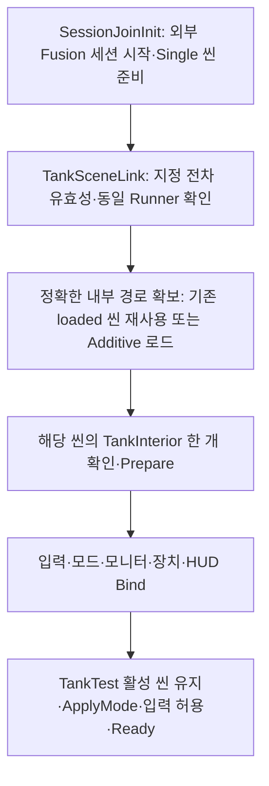

# TankTest 씬 분리 인계 README

작성일: 2026-11-07 · 작업 브랜치: `ksc` · 검증 Unity: **6000.6.3f1**

이 문서는 `TankTest` 내부를 새 `TankInterior` 씬으로 분리한 구성과 코드 변경, 팀별 수정 위치, 실행·디버그 방법을 설명한다. 경로는 Unity 프로젝트 루트인 `source/Claustrophobia/`를 기준으로 한다.

바로 찾기:

- [실행 방법](#1-빠른-실행) · [분리 전후·씬 배치](#2-분리-전후와-현재-배치) · [시작·준비 상태](#3-시작-순서와-준비-상태)
- [Inspector·경계 참조](#4-inspector-연결과-18개-경계-참조) · [코드·API 변경](#5-파트별-코드api-변경) · [해제·수명 계약](#6-연결-해제실패씬-소유권-계약)
- [앞으로 수정할 위치](#7-앞으로-수정할-위치와-인계-시-주의점) · [현재 조작](#8-현재-조작과-기능-확인-순서) · [디버그](#9-디버그-메뉴와-문제-확인)
- [기존 제한](#10-기존-제한과-유지한-예외) · [검증·산출물](#11-검증-근거와-로컬-산출물) · [변경 파일·재검증·복구](#12-파일-변경설정재검증과-복구)

**씬 분리 구현, Editor 회귀, Windows Player 빌드와 실제 별도 Host·Client 검증을 완료했다.** 현재 네트워크 담당자가 구현한 기능 범위에서 동작을 유지하는 것이 완료 기준이다. 기존 aim 누락과 게스트 포수 권한·원격 IK 등의 미구현 범위는 그대로다.

| 비교 기준 | 커밋 / 의미 |
| --- | --- |
| 분리 준비 전 | `8851377985567e9ed29e2d25585cac963e58fdcc` — main 반영 후 기존 단일 씬 |
| 실제 이동 직전 | `2951646b9962b1d73090cbb6cde9c0462b4db6f5` — 연결 API와 준비 중 외부 화면 유지까지 반영 |
| 실제 이동 | `a15458c` — 씬 추출 중간본. 자동 내부 로딩은 아직 없으므로 정상 실행 기준으로 사용하지 않음 |
| 자동 로딩 | `e8706fb` — TankTest 단독 Play에서 내부 자동 확보 |
| 제품 코드·Player 검증 기준 | **`cc11a247e73921433c0f9c2acebbd33f35321f63`** — 수명·예외 수정 포함. 이 README는 해당 기준의 인계 문서 |

이후 구현을 바꾸면 위 기준과 아래 검증 범위도 함께 갱신한다. 과거 [네트워크 구조 인계](TankCrew-Network-Handoff.md)와 [기능별 개발 안내](../Assets/TankPrototype/README.md)는 작성 당시 기록을 포함한다. 현재 씬 소속·연결·실행과 관련한 기준은 이 문서다.

## 1. 빠른 실행

### Editor

1. Unity **6000.6.3f1**로 저장소의 `source/Claustrophobia` 프로젝트를 연다.
2. [TankTest.unity](../Assets/TankPrototype/Scenes/TankTest.unity) **하나만 열고 Play**한다.
3. 외부 세션과 지정 전차가 준비되면 내부 씬이 자동으로 로드되고 연결된다. 기본 화면은 외부다.
4. Game 뷰에 포커스를 주고 키·버튼을 놓은 뒤 `F9`로 내부, `F8`로 외부를 확인한다.
5. 연결 상태를 확인하려면 Play 중 Hierarchy의 `NetworkAsset`을 선택하고 `Tools > Tank > Scene Link > Report Session Readiness (Play Mode)`를 실행한다.

정상 자동 시작의 기대값은 `Stage=Ready`, `Ready=true`, `SceneReady=true`, `Loading=false`, `Unloading=false`, `Owned=true`, `JoystickAimDeferred=true`, Error 비어 있음이다. `JoystickAimDeferred=true`는 현재 유지한 aim 예외를 뜻한다.

두 씬을 미리 열어 시작하는 경우도 검증했다. Fusion이 시작 과정에서 미리 열린 내부를 제거할 수 있으므로, 플레이 전 내부 객체나 씬 handle을 계속 보관해 사용하는 코드는 작성하지 않는다. **TankInterior 단독 Play는 전체 전차 기능의 실행 진입점이 아니다.**

### Windows Player

일반 검증 빌드는 로컬 `Builds/SceneSplitU11-2026-11-07/Player/Claustrophobia.exe`다. 실행·복사할 때는 `_Data`, `MonoBleedingEdge`, `UnityPlayer.dll` 등이 포함된 **Player 폴더 전체**를 사용한다.

`Builds/`는 Git에서 제외되므로 새 checkout에는 이 실행 파일과 검증 로그·백업이 없다. 필요한 팀원에게 산출물을 별도로 전달하거나 현재 소스로 빌드한다. 일반 실행에 임시 검증 스크립트나 Runtime Pipeline 서버는 필요하지 않다.

## 2. 분리 전후와 현재 배치

| 항목 | 분리 준비 전 | 현재 |
| --- | --- | --- |
| 씬 | TankTest 하나 | TankTest 외부 + TankInterior 내부 |
| 내부 루트 | TankTest 안의 Rooms / InteractionHUD / LocalTestMode | 세 루트 전체를 TankInterior로 이동 |
| 경계 연결 | Inspector의 직접 객체 참조 | 내부 로드 후 명시적 Bind API |
| 시작 | 각 컴포넌트가 이미 존재하는 참조를 사용 | 세션·전차 준비 → 내부 확보 → 준비·연결 → 출력 적용·입력 허용 |
| F8/F9 | 로컬 화면 모드 전환 | 동일한 화면 모드 전환. 씬 로딩·언로딩 키가 아님 |
| 활성 씬 | TankTest | 정상 연결 후에도 TankTest 유지 |
| 물리 | 기본 PhysicsScene | 두 씬이 같은 기본 PhysicsScene 공유 |
| 고정 계층 | 씬·프리팹에 배치 | 기존 배치를 유지. 실행 중 내부 계층 재생성 없음 |

```text
TankTest.unity                         외부 148개 객체 / 407개 컴포넌트
├─ TigerTank
│  ├─ NetworkObject / NetworkTransform / TankMotor / TankAim
│  ├─ TankGun / TankControl / TankInput / 외부 진단 HUD
│  └─ 운전·포수 feed 카메라와 외부 관측 카메라
├─ NetworkAsset
│  └─ NetworkRunner / SessionJoinInit / NetworkSceneManagerDefault / TankSceneLink
└─ 외부 환경 / 표적 / 외부 조명·Volume

TankInterior.unity                     내부 152개 객체 / 515개 컴포넌트
├─ Rooms                               TankInterior 컴포넌트
│  ├─ UpperRoom                        장치 / 포탄 / 모니터 / 그립·IK 기준점
│  └─ LowerRoom                        CrewPlayer / 좌석 / 내부 카메라·조작
├─ InteractionHUD
└─ LocalTestMode                       TankTestMode / 모드 안내
```

위 트리는 주요 소속을 설명한다. 총 GameObject는 전후 **300개**다. 최초 919개였던 컴포넌트는 `TankInterior`, `TankSceneLink`, 고정 `NetworkSceneManagerDefault`가 추가돼 **922개**가 됐다. 전차 내부에는 Fusion 컴포넌트를 추가하지 않았다.

### 보존한 데이터

- 기존 하위 계층·배치, Transform/RectTransform, 활성 상태, Collider/Layer, 카메라·오디오·Animator 설정.
- 모델·Avatar·재질·RenderTexture·Controller·클립·마스크 등 기존 에셋과 GUID.
- UpperRoom 43개 / LowerRoom 60개의 prefab property override와 중첩 프리팹의 유효 참조.
- 외부 NetworkObject와 NetworkedBehaviours의 대상·타입·순서.
- 기존 외부 환경 설정. 내부를 위해 새 기본 카메라·Light·Volume·EventSystem을 덧붙이지 않음.

TankTest GUID는 `914d3d4c2a76a6840a7ebcfc57287592`, 새 TankInterior GUID는 `6650d1d592178ed459d3fc926410b0bd`다. 이동한 씬 객체의 GlobalObjectId에는 새 씬 식별 정보가 반영되므로 이전 씬의 식별자를 그대로 비교 키로 사용하지 않는다. 이동 검증은 상대 계층 경로·컴포넌트 타입/순번·프리팹 원본·직렬화 속성으로 수행했다.

## 3. 시작 순서와 준비 상태



외부의 Fusion 시작은 기존 Single 방식이다. **내부는 그 준비가 끝난 뒤 Unity의 일반 Additive 로드로 확보**한다. 내부는 각 프로세스의 로컬 조작 공간이며 Fusion 네트워크 씬으로 추가하지 않는다.

| 상태 / API | 의미 |
| --- | --- |
| `SessionJoinInit.StartSucceeded` | StartGame 결과 성공 |
| `SessionJoinInit.HasSceneLoaded` | 지정 외부 씬의 로드 완료 확인 |
| `SessionJoinInit.IsSceneReady` | 위 두 조건 및 실행 중인 Runner·활성 세션 충족 |
| `TankInterior.IsPrepared` | 내부 구성과 좌석 초기화 완료. 네트워크 좌석 승인 완료와는 별개 |
| `TankSceneLink.IsReady` | 세션 준비 + 지정 NetworkObject 유효/동일 Runner + 내부 연결·출력 적용 + 제어 입력 허용 |
| `TankInput.IsInputReady` | 현재 연결에서 키를 놓고 다시 입력받을 준비가 됨. 세션 준비와 별도 |

일반 자동 시작은 `Waiting → Loading → Binding → Ready`로 진행한다. 이미 로드된 유효 내부를 사용하면 Loading을 생략할 수 있다. `Prepared`는 수동 준비 API에서 사용하는 상태이며 자동 시작의 필수 경유 상태가 아니다. 실패·수동 해제·종료는 각각 `Failed`, `Idle`, `Stopped`로 확인한다.

고정된 몇 초 대기나 새 로딩 UI를 추가하지 않았다. 준비 중에는 입력을 보호하고 외부 화면을 유지한다. 화면 출력과 AudioListener는 정상 조작 중 하나씩이며, 모니터용 RT 카메라는 별도로 동작한다.

## 4. Inspector 연결과 18개 경계 참조

### 고정 구성의 원본

| 위치 | Inspector에서 관리할 내용 |
| --- | --- |
| TankTest / NetworkAsset / `TankSceneLink` | `session`, `control`, `input`, `cameras`, `tankHud`, `gun`, `aim`, `driverFeed`, `gunnerFeed`, `interiorPath`, `bindJoystickAim` |
| TankInterior / Rooms / `TankInterior` | `crew`, `seats`, `interaction`, `mode`, `driveDevice`, `aimDevice`, `sight`, `driverScreen`, `breech`, `levers[2]`, `joystick`, `interactionHud` |

TankSceneLink의 외부 endpoint는 **지정한 같은 전차**를 가리켜야 한다. 두 feed 카메라도 그 전차 아래의 서로 다른 카메라여야 한다. 내부 조회는 로드한 정확한 씬의 루트 안에서 수행하며, 전역 검색으로 임의의 내부나 전차를 선택하지 않는다.

### 실행 중 연결되는 슬롯

| 연결받는 컴포넌트 | 연결 대상 | 참조 수 |
| --- | --- | ---: |
| 외부 TankControl | 내부 crew / driveDevice / aimDevice / sight | 4 |
| 외부 TankInput | 내부 seats / interaction / mode | 3 |
| 내부 TankTestMode | 외부 input / cameras / tankHud | 3 |
| 외부 TankKeyboardDebug | 내부 crew | 1 |
| 내부 좌우 TankLever | 외부 control, 각각 하나 | 2 |
| 내부 TankJoystick | 외부 control | 1 |
| 내부 DriverScreen | 외부 driverFeed | 1 |
| 내부 GunnerSight | 외부 gunnerFeed | 1 |
| 내부 TankBreech | 외부 gun | 1 |
| 내부 CrewInteractHud | 외부 control | 1 |
| 합계 | aim 보류 1개를 제외한 기존 정상 연결 | **18** |

**저장된 경계 슬롯이 비어 있는 것은 의도된 구성이다.** 씬 간 객체를 Inspector로 다시 직접 연결해 저장하지 않는다. 로컬 참조는 각 씬 안에 저장하고 경계 참조는 위 Bind 과정에서 전달한다. 저장된 유효 씬 간 직렬화 참조는 0개다.

현재 `interiorPath`는 `Assets/TankPrototype/Scenes/TankInterior.unity`다. [EditorBuildSettings.asset](../ProjectSettings/EditorBuildSettings.asset)의 enabled 순서는 TankTest=0, TankInterior=1이다. 코드는 경로로 인덱스를 확인하므로 숫자 1을 내부 로드 코드에 하드코딩하지 않는다. 다른 Build Profile이 자체 씬 목록을 사용한다면 그 목록에도 두 씬이 enabled이고 시작 씬이 TankTest인지 확인한다.

## 5. 파트별 코드·API 변경

기존 런타임 C# **12개**를 수정하고, 런타임 컴포넌트 **2개**와 Editor 도구 **1개**를 추가했다. 물리 이동·조준·무기 계산을 연결 관리자에 옮기지 않았다.

### 5.1 신규 준비·연결 컴포넌트

| 파일 | API와 책임 |
| --- | --- |
| [TankInterior.cs](../Assets/TankPrototype/Scripts/TankInterior.cs) | 내부 참조의 원본. `ValidateRefs(out reason)`는 조회·검사, `Prepare()`는 내부와 좌석 준비. 반복 Prepare로 현재 좌석을 초기화하지 않음 |
| [TankSceneLink.cs](../Assets/TankPrototype/Scripts/TankSceneLink.cs) | 외부/내부 검증, 씬 확보·소유권·해제, 동기 `Bind(TankInterior)`/`Unbind()`, 비동기 확보 요청 `LoadInterior()`, 상태·오류·StageChanged 제공 |

`LoadInterior()`의 true는 요청 수락 또는 기존 작업 사용을 뜻한다. 즉시 Ready가 됐다는 뜻은 아니다. `Bind`는 로드되지 않은 내부를 만들어 주지 않으며 세션·지정 전차 준비 조건도 우회하지 않는다. `PrepareInterior()`만 호출해서 입력이 열리지는 않는다.

### 5.2 입력·제어·좌석

| 파일 | 변경된 API / 흐름 | 유지한 동작 |
| --- | --- | --- |
| [CrewSeats.cs](../Assets/TankPrototype/Scripts/CrewSeats.cs) | `Start` 초기화를 `Initialize()`로 추출, `IsInitialized`, `Crew`, `ValidateRefs` 추가. Start와 Prepare가 같은 초기화를 사용 | `RequestSeat`, `SeatRequested`, `ResolveSeat` 승인 경로. `localSeats=false`일 때 Initialize만으로 역할을 승인하지 않음 |
| [TankControl.cs](../Assets/TankPrototype/Scripts/TankControl.cs) | `Bind(crew, drive, aimDevice, sight)`, `Unbind`, `CanInput`, `SetInputEnabled`, `InputVersion`. 장치 구독을 Attach/Detach로 정리 | 역할·장치 사용자 검사와 실제 행동 소유자의 API 호출. 입력이 닫혀도 gun의 회복 갱신은 계속 실행 |
| [TankInput.cs](../Assets/TankPrototype/Scripts/TankInput.cs) | `Bind(seats, interaction, mode)`, `Unbind`, `IsBound`, `CanInput`, `IsInputReady`. 준비 전 입력 차단과 연결 버전에 따른 키 재무장 | 키·마우스를 행동 요청으로 전달하는 기존 경로, 포커스 상실·비활성화 시 정리 |

개별 Bind는 필수 인자를 먼저 검사한다. 같은 대상 재호출은 현재 사용 상태를 불필요하게 초기화하거나 구독을 중복시키지 않는다. 연결 전체를 해제하면 명령과 장치 사용을 정리하고 참조를 비운다. 새 구성의 `TankControl.Awake`는 내부 crew가 없다는 이유로 외부 전차의 다른 로컬 crew를 대신 사용하지 않는다.

연결·모드 변경 뒤에는 키와 버튼을 놓고 다시 조작한다. `InputVersion`이 바뀌면 재무장하므로, 연결 전부터 누르던 Space/Enter가 새 사용·발사로 이어지지 않는다. `CanInput`과 OS 포커스/키 재무장은 별도 조건이다.

### 5.3 화면·장치·안내

| 파일 | 변경된 API / 흐름 | 유지한 동작 |
| --- | --- | --- |
| [TankTestMode.cs](../Assets/TankPrototype/Scripts/TankTestMode.cs) | `Bind(input, cameras, hud)`, `Unbind`, `ApplyMode`, `CanApply`, `IsBound`. 연결과 출력 적용을 분리하고 모드 값과 실제 출력 적용 여부를 구분 | F8/F9, 전차장 관측·복귀, 커서와 HUD의 기존 소유 관계 |
| [DriverScreen.cs](../Assets/TankPrototype/Scripts/DriverScreen.cs) | `Bind(Camera)`, `CanBind`, `Unbind`, `Feed`. 늦은 연결과 해제 처리 | 기존 RT와 재질을 사용. 새 RT/화면 계층 생성 없음 |
| [GunnerSight.cs](../Assets/TankPrototype/Scripts/GunnerSight.cs) | DriverScreen과 같은 연결 API | 기존 줌 계산·FOV 범위. 재연결 때문에 배율을 초기화하지 않음 |
| [TankBreech.cs](../Assets/TankPrototype/Scripts/TankBreech.cs) | `Bind(TankGun)`, `CanBind`, `Unbind`, `Gun`. 실제 구독 중인 gun과 장전 탄의 원래 gun 추적 | 기존 삽입·포미·탄 소비. 장전된 탄을 다른 gun으로 옮기는 Bind는 거부하고 같은 gun 재연결 시 현재 상태 반영 |
| [TankLever.cs](../Assets/TankPrototype/Scripts/TankLever.cs) | `Bind(TankControl)`, `Unbind`, `Control`. 적용·복원 함수를 활성화/연결에서도 재사용 | 기존 손잡이 기울기 계산. 해제 시 원래 손잡이 자세 복원 |
| [TankJoystick.cs](../Assets/TankPrototype/Scripts/TankJoystick.cs) | `Bind(control, aim)`, `Unbind`, `Control`, `Aim`. aim 보류용 `BindControl`/`UnbindControl` 추가 | 기존 기울기 계산과 해제 시 복원. 현재 씬의 aim 보류 상태 유지 |
| [CrewInteractHud.cs](../Assets/TankPrototype/Scripts/CrewInteractHud.cs) | `Bind(TankControl)`, `Unbind`, `Control`. 연결 변경 때 발사 안내 캐시 정리와 즉시 갱신 | 기존 역할·선택·가림 조건의 안내. 고정 UI를 런타임에 다시 생성하지 않음 |
| [TankKeyboardDebug.cs](../Assets/TankPrototype/Scripts/TankKeyboardDebug.cs) | `Bind(TankCrew)`, `Unbind`, `Crew`, `waitForBind`. 내부 crew를 명시적으로 받음 | 기존 진단 HUD와 카메라 추적. 준비 중 crew 미연결의 NONE 표시는 가능 |

TankTestMode의 `Bind`는 참조를 받고, `ApplyMode`가 현재/시작 모드 출력을 적용한다. 재연결 시 모드 값이 같아도 실제 출력이 해제돼 있었다면 다시 적용한다. Unbind·부분 실패에는 장치/관측/커서/출력을 정리한 뒤 SceneLink가 외부 화면과 안내를 복원한다.

현재 TankTest의 `TankControl`, `TankTestMode`, `TankKeyboardDebug` 인스턴스에는 명시적 연결 대기 설정을 사용한다. 기존 프리팹·다른 테스트 씬은 기본 `waitForBind=false` 경로와 기존 로컬 참조 fallback을 유지한다. 전차 프리팹 전체에 대기 설정을 일괄 적용하지 않는다.

### 5.4 네트워크 세션 진입·종료

[SessionJoinInit.cs](../Assets/TankPrototype/Scripts/network/SessionJoinInit.cs)는 기존 파일 중 시작·종료 흐름의 변화가 큰 부분이다.

| 이전 | 현재 |
| --- | --- |
| Start 시 우연히 활성화된 씬의 인덱스 사용 | Awake에서 자신이 배치된 외부 씬 경로·인덱스 캐시 |
| StartGame 호출 뒤 결과 확인 없음 | `StartSession()`에서 결과를 기다리고 성공/실패 기록 |
| 씬 준비 완료 상태 없음 | StartGame 성공과 지정 씬 로드 완료를 함께 확인한 `IsSceneReady` |
| 시작 취소·종료 통지 처리가 비어 있음 | 취소 토큰, 요청 번호, `StopSession()`, `SceneReady`/`Stopped` 이벤트 |
| OnInput에서 control 존재만 검사 | 동일 Runner·세션 준비·제어 허용 전에는 기본값 네트워크 입력 전달 |
| 씬 관리자 없으면 실행 중 추가 | 현재 TankTest는 고정 배치/필수 설정. 기존 구 테스트 씬은 종전 fallback 허용 |

**`Stopped` 이벤트는 일시적인 SceneReady 상실에도 발생할 수 있다.** `CurrentState`가 Starting/Running이면 연결 측은 Waiting으로 돌아가 준비 회복을 기다린다. 진짜 Stopped/Failed와 구별한다.

기존 `AutoHostOrClient`, `MySession`, 최대 3명, 공개/표시 설정은 유지했다. `TankCrewNetworkInput` 필드 구조와 `TankMotor`/`TankAim`의 네트워크 입력 선택·계산은 수정하지 않았다. 상태/준비 처리를 합치면서 기존 gate·취소·종료 callback을 제거하지 않는다.

종료·실패한 Runner의 같은 인스턴스 재시작은 이번 구현 범위에 없다. 검증한 새 세션 진입은 Play 재진입/새 Player 프로세스 실행이다. 내부 Unbind/Bind는 살아 있는 세션에서의 로컬 연결 복구다.

## 6. 연결 해제·실패·씬 소유권 계약

| 상황 | 입력·참조 | 내부 씬 / 상태 |
| --- | --- | --- |
| 정상 Ready | 연결 완료 후 입력 허용 | 한 개 유지, 현재 모드 출력 적용 |
| 수동 `Unbind()` | 입력 차단, 명령·사용·관측·커서·경계 구독/참조 정리, Idle | 로드된 내부 유지, 외부 화면 복원 |
| 로드 완료 후 관리자 disable | 연결 해제 | 내부 유지. 재활성화 시 같은 씬 재연결 |
| 로드 중 disable 후 완료 전 재활성화 | 중단된 요청 무효화, 유효 요청 재확인 | 같은 진행 중 로드를 인계받아 중복 로드 방지 |
| 로드 중 꺼진 채로 완료 | 늦은 완료가 입력을 열지 않음 | 불필요한 직접 소유 씬 해제 |
| 실제 세션 종료·관리자 파괴 | 입력과 연결 정리 | 직접 로드한 씬 해제. 빌린 씬은 임의로 제거하지 않음 |
| 잘못된 경로·필수 참조 누락·내부 0개/중복·부분 연결 실패 | 차단 상태와 오류 보고 | 원인을 고친 뒤 명시적 재시도. 잘못된 소유 내부 0개/중복 씬은 정리 |
| 내부 씬이 외부에서 제거됨 | 기존 외부 endpoint도 정리하고 Failed | 원인 해결 후 LoadInterior로 새 확보 요청 |

같은 대상 재연결에서 승인된 좌석·역할·줌·약실·이미 장전된 탄은 보존한다. 운반 중 포탄은 모드/사용 정리의 기존 경로로 반환된다. 장치 사용자와 남은 레버·조준 명령은 유지 대상이 아니다.

로드 작업은 실제로 하나만 진행한다. Ready 또는 로드 중 반복 `LoadInterior()`는 새 씬을 중복 생성하지 않는다. Unity 비동기 씬 로드가 시작된 뒤 요청 취소가 실제 로드를 즉시 취소한다고 가정하지 않는다. 완료 callback에서 요청 번호·활성 상태·세션·Runner·경로를 다시 검사한다.

연결 과정의 callback이 해제/종료/재연결을 요청할 수 있다. 이전 요청은 최신 연결을 덮어쓰거나 지우지 못하도록 각 연결 단계와 정리에 요청 번호를 사용한다. 내부 상태 전환은 정리를 마친 뒤 최종 상태를 통지한다. 실패 통지에서 시작한 새 재시도를 이전 정리가 지우지 않게 순서를 유지한다.

## 7. 앞으로 수정할 위치와 인계 시 주의점

| 작업 | 수정할 씬·컴포넌트 | 함께 확인할 연결 |
| --- | --- | --- |
| 내부 모델·장치 배치, Collider/Layer, 포탄 선반·포미, 그립/IK 타깃 | TankInterior의 Rooms/UpperRoom/LowerRoom 및 해당 기존 prefab | TankInterior 로컬 참조, CrewInteract.Devices, 장치 Parts/역할/거리/가림, prefab override |
| 좌석·승무원·고개·내부 시점·손 IK | TankInterior의 CrewPlayer, 좌석 앵커와 기존 Animator/IK 컴포넌트 | CrewSeats의 세 앵커, 로컬 승인 설정, 장치 UseChanged/해제 후 기존 blend |
| 레버·조이스틱 손잡이 표현 | 내부 TankLever/TankJoystick 및 원래 handle/grip | Bind/Unbind 계약과 중립 복원. 수식·Animator·Avatar는 이번 이관에서 유지 |
| 내부 HUD·모드 안내·관측 전환 | TankInterior의 InteractionHUD/LocalTestMode | TankTestMode와 CrewInteractHud의 Bind/Unbind, 카메라/오디오 단일 출력 |
| 외부 전차/물리·발사체·표적·환경 | TankTest의 TigerTank 및 외부 환경 | TankControl 소유 API, 네트워크 객체 등록, 외부 활성 씬과 발사체 소속 |
| 모니터 카메라·RT·재질 | feed 카메라는 TankTest, 모니터 Renderer는 TankInterior, 기존 RT/재질 에셋 | SceneLink driverFeed/gunnerFeed, 각 화면의 CanBind가 요구하는 같은 RT |
| 네트워크 접속·씬 준비·입력 전달·종료 | TankTest의 NetworkAsset와 SessionJoinInit | IsSceneReady, 지정 전차·동일 Runner, 미준비 시 0 입력, SceneLink 종료/재연결 |
| 내부 경로·확보·수명 정책 | TankSceneLink 및 Build Settings/사용 Build Profile | 정확한 경로, enabled 씬, 해당 씬 TankInterior 한 개, 소유/빌린 씬 구분 |

외부의 새 코드가 `Start`에서 내부가 이미 있다고 가정하지 않게 한다. 내부 접근은 `TankSceneLink.IsReady`/`StageChanged`에 맞추고, 이미 Ready인 시점에 구독하는 경우도 현재 상태를 먼저 확인한다. 자신의 구독 수명에 맞춰 해제한다.

활성 씬의 루트 목록에는 이제 외부 객체만 나온다. 내부는 SceneLink가 확보한 Interior/InteriorScene 또는 내부 소유자의 명시적 참조로 접근한다. 매 프레임 전역 Find로 대상을 다시 고르는 코드는 추가하지 않는다.

이전 브랜치에서 TankTest의 내부 계층을 편집한 내용은 현재 TankInterior의 대응 객체에 반영한다. 두 씬과 meta·필요한 연결 설정을 함께 검토하며, 과거 단일 씬이나 직접 경계 참조를 통째로 복원하지 않는다. 일반적인 내부 배치 수정 때문에 TankMotor/TankAim/SessionJoinInit을 함께 고칠 필요는 없다.

### 핵심 계산을 수정하지 않은 파일

`TankMotor`, `TankAim`, `TankGun`, `TankProjectile`, `TankCrew`, `TankRound`, `CrewCarry`, `CrewInteract`, `CrewLook`, `TankCrewCameras`, `CrewDebugView`, `TankCrewNetworkInput`은 분리 준비 전 기준과 소스가 같다. 기존 애니메이션 에셋·손 IK 계산도 이번 씬 분리를 위해 재작성하지 않았다. 수정된 레버·조이스틱은 연결·활성화·복원 시점이 달라진 부분을 위 표와 함께 확인한다.

## 8. 현재 조작과 기능 확인 순서

아래는 현재 TankInput/TankTestMode/CrewLook 소스 기준이다. 과거 안내의 독립된 외부 테스트 역할, Space 중립, 외부 R→T→Enter만으로 사격한다는 설명을 현재 TankTest에 그대로 적용하지 않는다. 이런 과거 안내와 현재 동작의 차이를 모두 이번 씬 분리에서 새로 바꾼 기능으로 해석하지 않는다.

| 조작 | 현재 동작 / 조건 |
| --- | --- |
| F8 / F9 | 외부 / 내부 화면. 씬은 계속 로드된 채로 유지 |
| 상단 1 / 2 / 3 | 조종수 / 포수 / 전차장 좌석·역할 요청. ReadSeat는 외부/내부 모드 공통이며 현재 같은 내부 crew에 연결 |
| 내부 화면 클릭 / 마우스 | 시선 잠금 / 내부 고개 회전. 포커스 필요 |
| Space | 선택 장치 사용/종료, 포탄 집기 또는 포미 상호작용. 레버 중립 키로 간주하지 않음 |
| Esc | 장치 사용 종료, 사용 중이 아니면 운반 탄 반환. 조건에 따라 내부 시선 잠금 해제 |
| 주행 장치 사용 중 W/S, I/K | 왼쪽/오른쪽 레버 증가·감소. 키를 떼면 값 유지 |
| 주행 장치 사용 중 Q/U | 왼쪽/오른쪽 레버 중립. 정지 확인은 양쪽 모두 중립으로 수행 |
| 주행 장치 사용 중 숫자패드 1~6 | 기존 주행 프리셋. 상단 좌석 숫자와 구별 |
| 포수 조이스틱 사용 중 방향키 / 휠 / Enter | 조준 / 포수 feed 줌 / 역할·장치·약실 조건을 거친 발사 |
| 내부 F6 / F7 | 장치 판정 디버그 / 후방 관찰 전환. 전차장 관측 사용 등에서 제한됨 |
| 전차장 관측 장치 사용 중 우클릭+마우스 | 외부 Commander Camera 관측. Space/Esc로 내부 복귀 |
| 외부 F3 / F4 | 역할 조건을 거친 전차장 관측 / 외부 3인칭 요청 |

외부 R/T/Y의 약실 테스트 요청 코드는 남아 있으나 현재 발사는 `RequestFire(interaction)`의 역할·장치 조건을 통과해야 한다. 무기 기능 확인은 아래 내부 상호작용 경로를 사용한다.

1. Ready를 확인하고 F9 → 키 해제 → 상단 1 → 주행 장치를 보고 Space. 레버 입력 후 Q/U로 중립, Space/Esc로 사용 종료를 확인한다.
2. 상단 2 → 조이스틱 Space → 방향키·휠. 실제 포탑/포신·모니터 배율과 해제 후 입력 정리를 확인한다. **손잡이 기울기는 aim 예외로 미동작 상태다.**
3. 보이는 포탄(예: Gunner shell 2)을 Space로 집고 Esc로 선반 복귀. 다시 집어 열린 포미에 삽입하고 Space로 닫는다.
4. 조이스틱 사용 상태에서 Enter로 한 발 발사한다. 중복 입력 거부와 회복, 이후 포미 조작을 확인한다.
5. 상단 3 → 전차장 관측 장치(`Rooms/UpperRoom/scope (1)`) Space → 우클릭 관측 → Space/Esc 복귀를 확인한다.
6. F8/F9와 포커스 이탈·복귀를 반복하고 키·버튼을 놓은 뒤 입력이 재개되는지 확인한다.

화면 모드 전환을 전체 전차 상태 리셋으로 사용하지 않는다. 실제 장치 사용 종료와 입력 정리 조건을 확인한다. 물리 키보드·마우스의 감각과 커서/화면 가독성은 팀원이 실제 Game 뷰/Player에서 최종 확인한다.

## 9. 디버그 메뉴와 문제 확인

도구: [Editor/TankLinkDebug.cs](../Assets/TankPrototype/Editor/TankLinkDebug.cs). **Play Mode에서 TankSceneLink가 붙은 NetworkAsset을 선택해야 메뉴가 활성화**된다. Fusion 동작 중 NetworkAsset이 DontDestroyOnLoad 쪽에 보일 수도 있다. 이 Editor 도구는 씬·프리팹을 저장하지 않는다.

공통 경로: `Tools > Tank > Scene Link`.

| 메뉴 | 용도 / 기대 결과 |
| --- | --- |
| Report Session Readiness (Play Mode) | Stage/Ready, 세션 시작·씬 준비, 경로·로딩·소유 여부와 오류 조회 |
| Report Presentation Bindings (Play Mode) | feed/gun/joystick control/HUD 연결 조회. 현재 JoystickAim만 false가 정상 기대값 |
| Unbind Session APIs (Play Mode) | 입력 차단·외부 화면 복원·Idle. 내부 씬은 유지 |
| Bind Session APIs (Play Mode) | 이미 확보된 같은 내부를 재연결. 정상 세션/전차 조건을 우회하지 않음 |
| Load Interior (Play Mode) | 내부 확보/복구 요청. 구성 오류를 고친 뒤 사용하며 완료는 Ready로 확인 |

첫 정상 보고의 주요 값:

```text
Stage=Ready, Ready=True
Session=Running, Started=True, SceneLoaded=True, SceneReady=True
Target=Assets/TankPrototype/Scenes/TankTest.unity
Interior=Assets/TankPrototype/Scenes/TankInterior.unity
Loading=False, Unloading=False, Owned=True
JoystickAimDeferred=True, Error=<비어 있음>
```

외부에서 이미 로드한 씬을 빌린 정상 구성에서는 Owned=false일 수 있다. 표현 보고는 DriverFeed/GunnerFeed/BreechGun/JoystickControl/HudControl/HudCrew=true, JoystickAim=false다. 아직 내부가 없으면 표현 보고는 그 상태를 출력하며 참조를 자동 수리하지 않는다.

| 증상 | 먼저 확인할 내용 |
| --- | --- |
| Waiting 유지 | Session 상태/LastError, Photon 접속, 지정 외부 씬, NetworkObject 유효·동일 Runner. 준비 조건을 우회해 내부를 수동 로드하지 않음 |
| 경로/Build Settings 오류 | interiorPath가 별도 enabled 씬인지, 사용 Build Profile에도 두 씬이 포함되는지 |
| 내부 구성 실패 | 해당 씬의 TankInterior가 정확히 한 개인지, Rooms의 로컬 참조/세 좌석 앵커/서로 다른 두 레버 확인 |
| 모니터 Bind 거부·화면 꺼짐 | 올바른 feed, 기존 targetTexture와 display.sharedMaterial.mainTexture 일치, 컴포넌트 활성 상태 |
| 다른 탱크/Runner 오류 | SceneLink endpoints와 SessionJoinInit.tankControl이 같은 지정 전차인지 |
| 재연결 후 키 무반응 | Ready와 포커스 확인 → 모든 키·버튼 해제 → 새 입력. 계속되면 연결/허용 상태 확인 |
| HUD 역할 NONE | 준비 중 crew 미연결일 수 있음. Ready 뒤 실제 crew 연결을 표현 보고로 확인 |
| 조이스틱 손잡이만 무반응 | 현재 aim 보류 예외. 네트워크 yaw/로컬 pitch와 별도로 확인 |
| 같은 경로 씬 중복 | Hierarchy의 중복 씬과 로드 호출 주체 확인. 정상 반복 요청은 SceneLink 한 경로 사용 |
| 종료 뒤 화면 소실 | Fusion이 외부 월드 자체를 제거한 종료 구간인지 확인. 살아 있는 외부의 준비/내부 실패 구간과 구별 |

중단점은 `SessionJoinInit.ApplyReady/OnInput`, `TankSceneLink.TryConnect/OnLoadDone/Bind/OnSessionStopped`, `TankInterior.Prepare`, `TankControl.SetInputEnabled`, `TankInput.ReadKeys`에 둘 수 있다. 정상 실행에서는 디버그 메뉴로 Bind를 눌러야만 시작되는 상태가 없어야 한다.

## 10. 기존 제한과 유지한 예외

### aim 연결 보류

TankJoystick.Aim은 분리 전부터 실제 null/Missing이었다. 현재 TankTest의 SceneLink는 **bindJoystickAim=false**이며 control만 연결한다. Ready는 이 정책을 포함한 준비 완료를 뜻한다.

기존 깨진 fileID `1304813870`은 이동·저장 중 새 씬에서 0으로 정규화됐다. 실제 미연결 상태와 손잡이 기울기 미반응은 유지됐다. 담당자가 연결할 때는 SceneLink의 `bindJoystickAim`과 `TankJoystick.Bind(control, aim)` 경로를 검토하고, 재연결·기울기·그립 반응을 별도 재검증한다. 씬 간 직접 aim 참조를 저장하는 방식은 사용하지 않는다.

### 네트워크 범위

- 기존 접속·준비·Host 입력 기반 yaw 수신·종료 정리까지 검증했다.
- 로컬 역할/장치 사용은 네트워크 좌석 점유·입력 권한 부여를 뜻하지 않는다. localSeats의 기존 승인 API를 유지했다.
- 게스트 포수 권한 전체, 원격 손 IK·조이스틱, 무기/탄약 전체 동기화, Host migration·새 재접속 UI를 추가하지 않았다. 이를 이번 인계의 미완료 작업으로 배정하지 않는다.
- 실제 별도 프로세스 검증은 같은 Windows PC에서 수행했다. 다른 PC/WAN 조건이나 3명 동시 좌석 경쟁까지 통과한 것으로 확대하지 않는다.

### 관찰된 Client 초기 1프레임 공백

첫 Client와 새 Client 재접속에서 각각 약 **6.079ms / 6.147ms**의 1프레임 출력 공백이 기록됐다. 당시 지정 전차는 비활성/NetworkObject 미등록, 입력 차단, SceneLink=Waiting, **내부 IsLoading=false**였다. Fusion의 [NetworkSceneManagerDefault.cs](../Assets/Photon/Fusion/Runtime/NetworkSceneManagerDefault.cs) `RegisterSceneObjects` 호출부에는 Client 객체를 비활성화한다고 명시돼 있고 실제 기록과 일치한다.

이 SDK 등록 구간의 동작은 그대로 기록했다. 내부 Loading/Ready와 정상 조작에서 추가 공백은 관찰되지 않았다. 별도 임시 카메라나 고정 대기 기능을 더하지 않았다.

### 그 밖의 기존 제한

- Gunner shell 1은 원래 양쪽 고정 좌석에서 가려져 있다. 이번 Player 검증에서도 집기 차단을 확인했고 배치·콜라이더를 바꾸지 않았다.
- 최적화된 Animator의 노출되지 않은 손뼈는 Transform 거리 측정에 제한이 있다. IK layer/blend 확인을 모든 손 자세의 시각적 완성도로 해석하지 않는다.
- 기본 PhysicsScene을 공유하므로 씬 분리만으로 충돌·빛·카메라 영향이 완전히 격리되는 구성은 아니다. 기존 좌표/레이어/culling 설정을 유지한다.
- 예열된 Bind/Ready 감시 루프의 0-byte 측정은 해당 Editor 호출 경로 결과다. 전체 프레임/Player GC.Alloc이나 성능 보장이 아니다.
- Player 시작 로그의 사용하지 않는 URP 후처리 shader stripping 안내와 QA 코드의 deprecated API 경고는 기능 결과와 구분했다. 이번에 그래픽 설정/패키지를 개편하지 않았다.

## 11. 검증 근거와 로컬 산출물

아래 수치는 각각 해당 기준에서 실행한 검사다. Editor/Player 수치를 합쳐 하나의 기능 개수로 해석하지 않는다.

| 검증 | 완료 내용 |
| --- | --- |
| 기존 기능 C0 | 기존 기능 232개 + 별도 시간 경과 주행/Host yaw/local pitch. 알려진 aim 기울기 실패 분리 기록 |
| U09/U10 Editor | 기존 기능 232개 포함 764개 조건, 수명·예외 31개 시나리오/129개 조건, 기본 Domain+Scene Reload와 기존 빠른 Play 설정, 프리팹·구 씬 호환 |
| U11 일반 Player | Windows x64 Mono 빌드 성공, 오류 0. 실제 Host 실행·외부 화면·정상 종료. 임시 QA 타입이 일반 Assembly-CSharp.dll에 없음을 확인 |
| U11 개발 Player | 실제 Host/Client 별도 프로세스, Player API 155개 + 접속·동기화·보존 51개 확인 |
| 네트워크 증거 | Host/Client가 같은 객체 `[Id:1025]` 사용. 정지 후 양쪽 yaw와 새 Client의 초기 수신 yaw 모두 189.375도 |
| 종료/재접속 | Client 종료 후 Host 유지 → 새 Client 프로세스 재접속 → Host 종료 후 Client 내부/입력 정리 |
| 원본 보존 | U11 전후 Assets/Packages/ProjectSettings 원본 2,725개 파일 해시 일치, 최종 임시 코드·설정 제거, Git 작업 트리 깨끗함 |

전체 Editor 회귀의 강제 시작 취소에서 발생한 Fusion `OperationCanceled` 로그 1건은 예상 로그로 분리했다. Player 완료 실행의 관찰된 Runtime Error/Exception/Assert는 0개다. 일부 실패·중단 조건은 테스트용 상태로 강제했으며 자연 발생 관찰만으로 검증한 것은 아니다.

Editor의 일부 입력 검사는 가상 Input System 이벤트/ReadKeys로 OS 포커스 조건을 제외했다. U11의 집중된 Client F8/F9·좌석 키는 Input System의 onBeforeUpdate에 이벤트를 넣고 실제 Player Update에서 처리했다. OS 물리 키보드 전수 수동 검사와 구별한다. GUI 자동 조작의 불분명한 F9 결과는 통과에 포함하지 않았다.

**다음 경로는 Git에 없는 검증 머신의 로컬 자료다.** 새 checkout에서 링크가 자동으로 생기지 않으므로 경로로 표기한다. 상세 자료가 필요한 팀원에게 보고서/JSON/Player 폴더를 별도 전달한다. 임시 검증 소스를 Assets에 다시 넣는 것은 정상 실행 절차가 아니다.

| 로컬 경로 | 내용 |
| --- | --- |
| `Builds/SceneSplitC0-2026-11-07/154101/` | 원래 단일 씬의 상태·기능·aim 누락·전체 백업 |
| `Builds/SceneSplitU07-2026-11-07/` | 이동 전후 객체/참조/override 비교, 씬 체크포인트 |
| `Builds/SceneSplitU08-2026-11-07/` | 자동 로딩 검증과 중간 결과 |
| `Builds/SceneSplitU09U10-2026-11-07/U09U10-report.txt` 및 `verification.json` | 수명/회귀 최종 결과, 백업·코드 체크포인트 |
| `Builds/SceneSplitU11-2026-11-07/U11-report.txt` 및 `verification.json` | Player/실제 Host·Client 결과, 초기 도구 보정 이력과 제한 |
| `Builds/SceneSplitU11-2026-11-07/Player/` | 검증 코드 없는 일반 Windows 빌드 |
| `Builds/SceneSplitU11-2026-11-07/client-interior.png` | 실제 Client 포수 모니터 렌더 |
| `Builds/SceneSplitU11-2026-11-07/pre-u11-backup.zip` | cc11a24 원본 2,725개 파일. ZIP CRC 검사 정상 |

QAPlayer/QAClient는 계측용 개발 산출물이며 임시 Runtime Pipeline을 포함한다. 일반 실행/전달에는 Player 폴더를 사용한다. QA의 초기 `u11_test weapon`은 잘못된 가시성 가정을 가진 실험용 helper라 완료 검사로 사용하지 않았다. 최종 무기 검사는 `player-weapon-check.cs`를 각 실제 Player의 eval_file로 실행한 결과이며, 가려진 탄을 통과시키기 위한 콜라이더 변경이 없다.

## 12. 파일 변경·설정·재검증과 복구

### 전체 변경을 검토할 범위

- 기존 C# 12개: CrewSeats, TankControl, TankInput, TankTestMode, DriverScreen, GunnerSight, TankBreech, TankLever, TankJoystick, CrewInteractHud, TankKeyboardDebug, SessionJoinInit.
- 신규 C#: TankInterior, TankSceneLink, Editor/TankLinkDebug 및 필요한 meta/Editor 폴더 meta.
- 씬: 기존 TankTest 수정, 신규 TankInterior 및 meta.
- 설정: EditorBuildSettings에 내부 enabled 항목 추가.
- 전체 `8851377 → cc11a24` Git 차이에는 EditorSettings의 직렬화 버전 11→16 및 에디터 필드 갱신도 포함된다. Unity의 설정 직렬화 갱신으로 보이며 씬 연결 기능과 구분한다. `Enter Play Mode Options enabled=true/options=3`은 유지했다.

각 단계 보고서의 “설정 보존”은 그 단계의 작업 전후 비교다. 위 전체 커밋 간 차이를 모두 없었다고 해석하지 않는다. U11 중 빌드가 줄바꿈만 다시 쓴 URP/Graphics/Player 설정 네 파일은 작업 전의 정확한 바이트로 복원했다. 임시 Runtime Pipeline 설정도 제거했고 최종 enableInBuilds=false를 확인했다.

### 후속 수정 후 필요한 범위의 재검증

| 수정한 것 | 확인할 것 |
| --- | --- |
| 내부 배치·prefab override | 저장/재열기, 로컬 참조·좌석·그립/장치 선택/가림·포탄/포미 |
| 연결·입력·모드 | TankTest 단독 Play, Ready 전 보호, F8/F9·관측·포커스·키 재무장, Unbind/Bind, 좌석·약실 보존 |
| 로더·세션·씬 경로 | 두 씬 미리 열기, 반복 요청, 로드 중 disable-enable/종료, 늦은 완료, 소유 씬 정리, 실제 Host·별도 Client |
| 화면·RT·오디오 | 모니터 실제 영상, 단일 주 화면/AudioListener, 해제·실패 시 외부 화면, 외부 활성 씬·발사체 소속 |

변경과 관계없는 미구현 네트워크 기능을 이 검증의 완료 조건으로 새로 추가하지 않는다.

### 복구 기준

1. 현재 수정과 미저장 씬을 별도로 보관하고 Play를 종료한다.
2. 현재 분리본의 기준은 `cc11a24`다. 이 기준의 **두 씬·meta·연결 코드·필요 설정을 일관된 묶음**으로 복원한다. 새 로더만 남기고 오래된 단일 씬을 덮거나, 내부 씬만 지우는 방식은 피한다.
3. 실제 이동 전 정상 한 씬 기준은 `2951646`이다. 로컬 U07 보고서/백업의 전체 복구 절차를 함께 확인한다. 자동 로더가 없는 중간 `a15458c`를 완료본으로 넘기지 않는다.
4. 복원 뒤 컴파일, 저장 씬 재열기, 단독 Play와 해당 기능을 확인한다. 이후 팀원 수정까지 과거 백업으로 덮지 않게 복원 파일을 구분한다.

이번 인계 기준에는 기존 aim 예외와 이미 구현된 네트워크 범위가 포함돼 있다. 후속 변경은 담당 파트의 씬/소유 API에서 수행하고, 이 문서의 실행·연결·제한·검증 기준을 함께 갱신한다.
